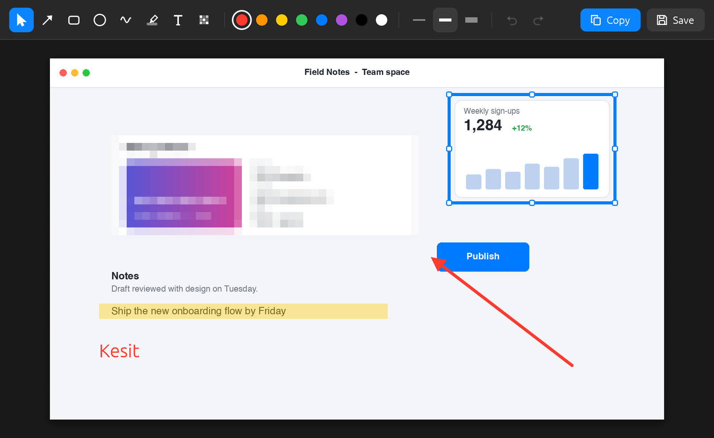

# Kesit

[](https://github.com/emre6943/Kesit/actions/workflows/ci.yml)
[](https://github.com/emre6943/Kesit/releases/latest)
[](LICENSE)

Kesit is a small screenshot tool for macOS and Linux: press a hotkey, drag over part of the
screen, mark it up, then copy or save it.

<picture>
  <source media="(prefers-color-scheme: light)" srcset="docs/screenshot-light.png">
  
</picture>

*Kesit* is Turkish for "cross-section".

## Features

- Global hotkey and a menu bar (tray) icon; the background process uses no GPU and stays near
  zero CPU.
- Freezes the monitor under the cursor, so menus and hover states stay put while you select.
- Arrow, rectangle, ellipse, pen, highlighter, text and pixelate tools.
- Every annotation stays editable: select, move, resize, recolour, delete, with undo and redo.
- Exports at the full resolution of the capture.
- Copies to the clipboard or saves a timestamped PNG.
- Opens existing images too (`kesit edit <file>`).
- Makes no network connections.

## Install

### macOS with Homebrew

```sh
brew install --cask emre6943/tap/kesit
```

Kesit needs macOS 14 (Sonoma) or later and runs natively on Apple Silicon and Intel Macs.

### macOS, direct download

Download `Kesit-<version>-macos-universal.dmg` (or the `.zip`) from the
[latest release](https://github.com/emre6943/Kesit/releases/latest), open it and drag Kesit into
Applications. Then open Kesit from Applications; it appears as an icon in the menu bar, not in the
Dock.

Releases are meant to be signed and notarized by Apple. If a release says it is *not notarized*,
macOS blocks the first launch with a message that it cannot check the app for malicious software.
To open it anyway: System Settings → Privacy & Security, scroll down to the message about Kesit,
click **Open Anyway** and confirm. This applies to the Homebrew cask as well. You only need to do
this once per version.

### Install script (macOS and Linux)

```sh
curl -fsSL https://raw.githubusercontent.com/emre6943/Kesit/main/scripts/install.sh | bash
```

The script downloads the latest release, checks it against the release's `SHA256SUMS` and
installs it for the current user without `sudo`: `Kesit.app` into `/Applications` on macOS,
`~/.local/bin/kesit` plus a launcher and icon on Linux (x86_64 only). Read
[the script](scripts/install.sh) first if you prefer.

### Linux, manual

Download `kesit-<version>-linux-x86_64.tar.gz` from the
[latest release](https://github.com/emre6943/Kesit/releases/latest), then:

```sh
tar -xzf kesit-*-linux-x86_64.tar.gz
./kesit-*-linux-x86_64/install-linux.sh
kesit &
```

The binary needs GTK 3 at runtime, and a tray icon needs libayatana-appindicator (both are
present on most desktops). The prebuilt binary is built on Ubuntu 22.04.

### Build from source

Kesit needs Rust 1.95 or later.

```sh
git clone https://github.com/emre6943/Kesit && cd Kesit
./scripts/bundle-macos.sh        # macOS: builds dist/Kesit.app (signed ad hoc)
./scripts/install-linux.sh       # Linux: builds and installs into ~/.local/bin
```

On macOS, copy `dist/Kesit.app` to `/Applications` and open it. Build dependencies on Debian and
Ubuntu:

```sh
sudo apt install pkg-config libgtk-3-dev libxdo-dev libayatana-appindicator3-dev \
  libxcb1-dev libxcb-randr0-dev libpipewire-0.3-dev libclang-dev libwayland-dev \
  libegl-dev libdbus-1-dev libgbm-dev
```

An ad-hoc signature changes with every build, so macOS may ask for the Screen Recording
permission again after a rebuild. Signing with a stable identity avoids that:

```sh
KESIT_SIGN_IDENTITY="Apple Development: Your Name (TEAMID)" ./scripts/bundle-macos.sh
```

## Usage

Start Kesit once (open the app, or run `kesit`). It stays in the menu bar or system tray with
**Capture**, **Settings…** and **Quit Kesit**.

Press the hotkey (`Cmd+Shift+S` on macOS, `Ctrl+Shift+S` on Linux) and drag over the area you
want. Enter or a double-click takes the whole screen, Esc cancels. The editor opens on the
selection; any number of editors can be open at once.

| Command | What it does |
|---|---|
| `kesit` | Background process: global hotkey and tray menu. No window, no Dock icon. |
| `kesit capture` | Freezes the monitor under the cursor and opens the editor on the selection. |
| `kesit edit <image>` | Opens the editor on an existing image. Saving writes a new file. |
| `kesit settings` | Opens the settings window. |

### Editor shortcuts

| Key | Action |
|---|---|
| `V` | Select: click an annotation to select it, drag to move, drag a handle to resize |
| `A` `R` `O` `P` `H` `T` `B` | Arrow, Rectangle, Ellipse, Pen, Highlighter, Text, Pixelate |
| `1` `2` `3` | Thin, medium, thick stroke |
| Shift while dragging | Square or circle; a straight line for the pen and highlighter |
| Delete / Backspace | Delete the selected annotation |
| Arrow keys (with Shift: ×10) | Nudge the selected annotation by 1 point (10 points) |
| Cmd/Ctrl+Z, Cmd/Ctrl+Shift+Z | Undo, redo |
| Cmd/Ctrl+C or Enter | Copy the annotated image (and close, by default) |
| Cmd/Ctrl+S | Save `Kesit YYYY-MM-DD at HH.MM.SS.png` to the save folder (and close, by default) |
| Esc | Deselect; with nothing selected, close without saving |

Any tool can grab an existing annotation by its outline; with the Select tool the inside of
rectangles and ellipses counts too. Picking a colour or stroke width while an annotation is
selected changes that annotation.

Text: click and type. Enter or a click elsewhere commits, Shift+Enter starts a new line, Esc
cancels. Double-click a text annotation to edit it again; drag its corner handles to resize it.

Pixelate replaces the area with blocks averaged over the original pixels, in the preview and in
the exported image alike, so the hidden detail cannot be recovered from the PNG.

## Settings

Open **Settings…** from the tray menu. You can change the hotkey, the save folder (Downloads by
default), whether the editor closes after copying or saving, whether a saved file is shown in
Finder or the file manager, the default colour and stroke, and **Launch Kesit at login**. The
editor remembers the last tool, colour and stroke you used.

Settings are stored in `config.toml` in `~/Library/Application Support/kesit/` on macOS and
`~/.config/kesit/` on Linux:

```toml
hotkey = "Cmd+Shift+S"
save_dir = "/Users/you/Downloads"   # must be an absolute path
autostart = true
color = "#FF3B30"
stroke_width = 4.0
tool = "arrow"
close_after_copy = true
close_after_save = true
reveal_after_save = true
```

A missing or unreadable file falls back to the defaults, and an invalid value falls back to its
own default.

## Permissions on macOS

Kesit needs the **Screen Recording** permission. On the first capture macOS asks for it; allow
Kesit under System Settings → Privacy & Security → Screen & System Audio Recording, then quit
Kesit from the menu bar and open it again. Until then a capture shows only the wallpaper and the
menu bar. The global hotkey needs no extra permission.

Launch at login is a LaunchAgent (`~/Library/LaunchAgents/org.versesoftware.kesit.plist`),
written only when Kesit runs from an `.app` bundle.

## Linux notes

- **X11:** global hotkey, capture of the monitor under the cursor, overlay, clipboard, tray and
  autostart are implemented.
- **Wayland:** compositors do not let applications register global hotkeys or read the global
  cursor position. Bind a desktop shortcut (for example GNOME Settings → Keyboard → Custom
  Shortcuts) to `kesit capture`; it captures the primary monitor. The tray menu works where the
  desktop shows tray icons.
- **Status:** Kesit is developed on macOS. The Linux build compiles and its tests pass in CI, but
  the X11 and Wayland paths (capture, overlay, clipboard, tray, autostart) have had little or no
  testing on a real desktop. Reports are welcome.

## Uninstall

Turn off **Launch Kesit at login** in Settings and quit Kesit first.

- **Homebrew:** `brew uninstall --cask kesit`; add `--zap` to remove settings and caches too.
- **macOS, manual:** delete `/Applications/Kesit.app`, then optionally
  `~/Library/Application Support/kesit`, `~/Library/Caches/kesit`,
  `~/Library/Preferences/org.versesoftware.kesit.plist` and
  `~/Library/LaunchAgents/org.versesoftware.kesit.plist`. Remove Kesit from the Screen Recording
  list in System Settings if you like.
- **Linux:** delete `~/.local/bin/kesit`, `~/.local/share/applications/kesit.desktop`,
  `~/.local/share/icons/hicolor/256x256/apps/kesit.png`, `~/.config/kesit` and
  `~/.config/autostart/Kesit.desktop`.

## Privacy

Kesit makes no network connections and has no telemetry. Screenshots stay in memory until you
copy or save them; nothing leaves your machine unless you paste or send it somewhere yourself.
Only the optional install script downloads anything, from this repository's GitHub releases.

## Contributing

Bug reports, Linux test reports and pull requests are welcome. See
[CONTRIBUTING.md](CONTRIBUTING.md); report security issues as described in
[SECURITY.md](SECURITY.md).

## Licence

MIT. See [LICENSE](LICENSE).
